<p align="center">
  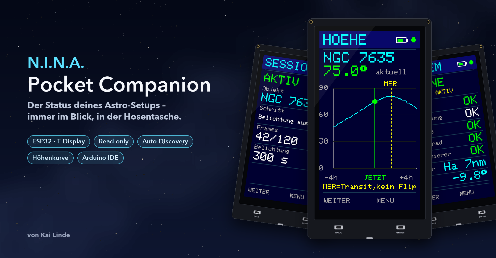
</p>

<p align="center">
  
  
  
  
  
  <a href="LICENSE"></a>
</p>

<p align="center">
  <b>Der Status deines Astro-Setups – immer im Blick, in der Hosentasche.</b><br>
  Ein ESP32 mit 1,14″-Display zeigt live, was <a href="https://nighttime-imaging.eu/">N.I.N.A.</a> gerade tut:<br>
  Session, Kamera, Guiding, Filterrad, Ziel und Höhenverlauf – ohne zum Rechner zu laufen.
</p>

---

## ✨ Highlights

| | |
|---|---|
| 🔭 **Statusanzeige, keine Fernsteuerung** | Die Firmware sendet ausschließlich `HTTP GET`. Es gibt keinen Code zum Starten, Stoppen, Verstellen oder Bewegen. |
| 📡 **Auto-Discovery** | Leere Host-Angabe genügt: Der Companion findet den N.I.N.A.-PC im lokalen Netz selbst und merkt sich die Adresse. |
| 📈 **Höhenverlauf** | ±4 Stunden um jetzt, berechnet aus RA/Dec der Montierung und deinem Standort – inkl. Meridiandurchgang. |
| 🧊 **Ehrliche Anzeige** | Fehlende Werte erscheinen als `--`. Ist N.I.N.A. kurz weg, bleiben die letzten Werte sichtbar und sind mit `ALT` markiert. |
| ⚡ **Ruhiges, gut lesbares Bild** | Große Schrift für alle Werte, flackerfreier Bildaufbau. Die Tasten bleiben auch bei Netzproblemen bedienbar. |
| 🔋 **Akku & Stromsparen** | Akkusymbol mit Füllstand in der Kopfzeile. Das Display geht nach einstellbarer Zeit aus und wacht per Tastendruck – oder von selbst bei wichtigen Ereignissen – wieder auf. |
| 🧰 **Minimal-Hardware** | Ein LilyGO T-Display, optional ein Akku – Installation komplett über die Arduino IDE, [Gehäuse zum Drucken](hardware/gehaeuse) inklusive. |

## 📱 Ansichten

<table>
  <tr>
    <td align="center">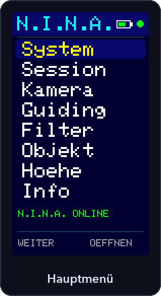</td>
    <td align="center">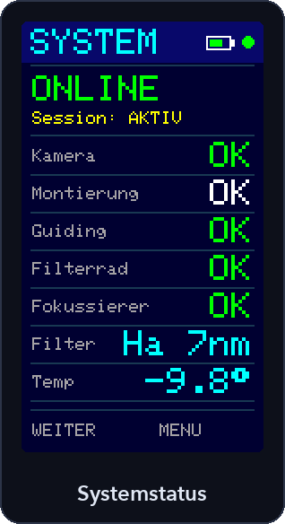</td>
    <td align="center">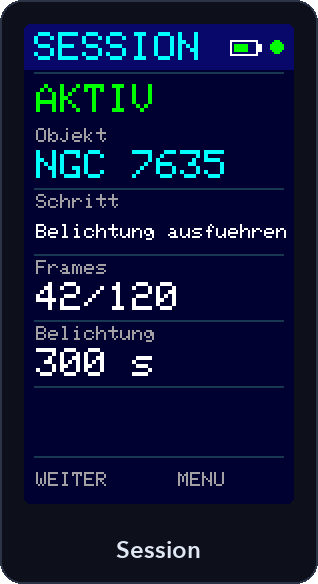</td>
  </tr>
  <tr>
    <td align="center">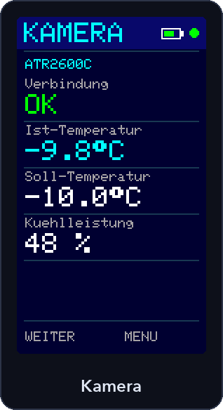</td>
    <td align="center">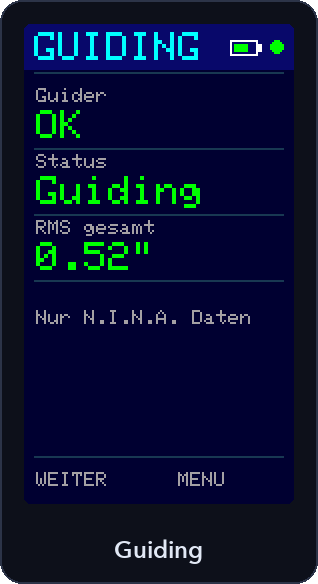</td>
    <td align="center">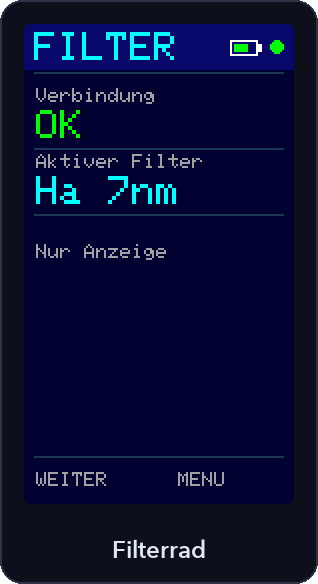</td>
  </tr>
  <tr>
    <td align="center">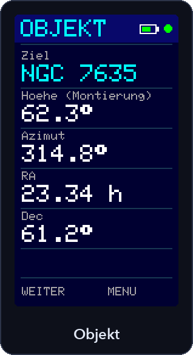</td>
    <td align="center">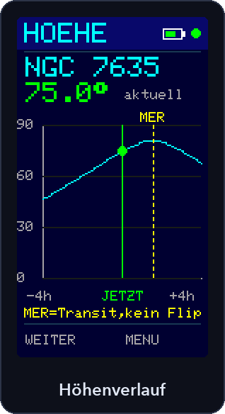</td>
    <td align="center">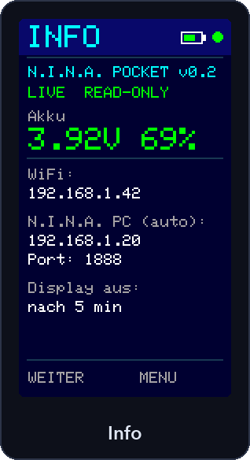</td>
  </tr>
</table>

> [!NOTE]
> Die Bilder sind **pixelgenaue Mockups** mit Demodaten: Sie werden von [`tools/render_mockups.py`](tools/render_mockups.py) mit denselben Koordinaten, Farben und derselben 5×7-Schrift erzeugt wie auf dem echten 135 × 240-Display.

## 📸 Im Einsatz

*Fotos vom echten Gerät am Teleskop folgen.*

<!--
  Fotos nach docs/images/photos/ legen und hier einbinden, z. B.:
  <p align="center">
    
    
  </p>
-->

## 🧩 So funktioniert's

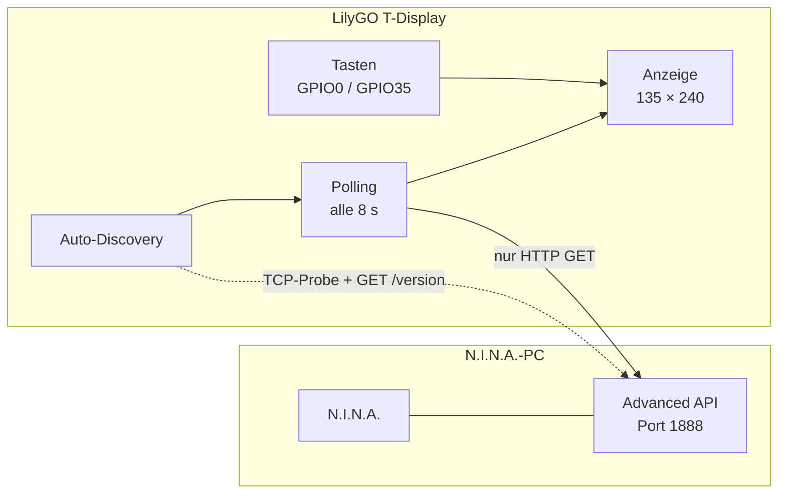

## 🛠️ Hardware

| Bauteil | Details |
|---|---|
| Board | Klassisches **LilyGO/TTGO T-Display**, ESP32, 1,14″ ST7789V, 135 × 240 px |
| Display | MOSI GPIO19 · CLK GPIO18 · CS GPIO5 · DC GPIO16 · RST GPIO23 · BL GPIO4 |
| Tasten | GPIO0 (**WEITER**) · GPIO35 (**ÖFFNEN / ZURÜCK**) |
| Akku (optional) | LiPo 1100 mAh, 47 × 29 × 8 mm |
| Gehäuse | 3D-druckbar, siehe [`hardware/gehaeuse`](hardware/gehaeuse) |

Dokumentation: [LilyGO T-Display Wiki](https://wiki.lilygo.cc/products/t-display-series/t-display/)

## 🚀 Schnellstart (Arduino IDE)

1. **Arduino IDE** öffnen und das **ESP32-Boardpaket von Espressif** installieren.
2. Im Bibliotheksverwalter installieren:
   - `Adafruit GFX Library`
   - `Adafruit ST7735 and ST7789 Library`
   - `ArduinoJson` (Version 7)

   Adafruit BusIO wird als Abhängigkeit mitinstalliert.
3. [`NINA_Pocket_Companion/NINA_Pocket_Companion.ino`](NINA_Pocket_Companion/NINA_Pocket_Companion.ino) öffnen, `secrets.h` anlegen und konfigurieren (siehe unten).
4. Board **ESP32 Dev Module** und die richtige serielle Schnittstelle wählen, hochladen. Im Zweifel Flash 4 MB, PSRAM disabled.
5. In N.I.N.A. das Plugin **Advanced API** aktivieren. Es muss vom T-Display im selben Netzwerk erreichbar sein (Standard-Port 1888, ggf. Windows-Firewall für lokalen Zugriff freigeben).

> [!TIP]
> Zum Ausprobieren ohne N.I.N.A. `DEMO_MODE = true` setzen. Demowerte sind auf dem Display eindeutig als Demo markiert.

## ⚙️ Konfiguration

**Private Daten** – WLAN-Zugang und Standort – gehören in `NINA_Pocket_Companion/secrets.h`. Die Datei steht in der `.gitignore` und landet nie auf GitHub. Kopiere dazu [`secrets_example.h`](NINA_Pocket_Companion/secrets_example.h) nach `secrets.h` und trage deine Werte ein:

| Eintrag in `secrets.h` | Bedeutung |
|---|---|
| `SECRET_WIFI_SSID`, `SECRET_WIFI_PASS` | Zugangsdaten deines WLANs |
| `SECRET_SITE_LAT`, `SECRET_SITE_LON` | Standort deiner Sternwarte für die Höhenkurve in Dezimalgrad, Länge Ost positiv. Absichtlich `NAN` vorbelegt, damit keine falsche Kurve erscheint. |

Alles Weitere steht oben im Sketch im Block `CONFIGURE HERE`:

| Konstante | Bedeutung |
|---|---|
| `NINA_HOST` | IP des N.I.N.A.-PCs – **leer lassen für Auto-Discovery** |
| `NINA_PORT` | Port der Advanced API (Standard `1888`) |
| `DEMO_MODE` | `true` zeigt Demodaten ohne Netzwerk |
| `POLL_MS` | Abfrageintervall in Millisekunden (Standard 8000) |
| `DISPLAY_TIMEOUT_MIN` | Display nach so vielen Minuten ohne Tastendruck ausschalten (Standard 5, `0` = immer an) |
| `POLL_MS_DISPLAY_OFF` | Abfrageintervall bei ausgeschaltetem Display (Standard 30000) – spart Strom |
| `WAKE_ON_EVENTS` | Display bei Sequenzende, Verbindungsverlust oder leerem Akku selbst einschalten (Standard `true`) |
| `BATTERY_MONITOR` | Akkumessung an GPIO34 (Standard `true`; auf `false` setzen, wenn kein Akku angeschlossen ist) |

> [!TIP]
> Fehlt `secrets.h`, kompiliert der Sketch trotzdem – mit Platzhaltern, also ohne WLAN-Verbindung.

### 📡 Auto-Discovery

Ist `NINA_HOST` leer, sucht der Companion den N.I.N.A.-PC selbst:

1. Zuerst wird die **zuletzt gefundene Adresse** (im Flash gespeichert) geprüft – meist ist der Companion damit sofort verbunden.
2. Antwortet sie nicht, werden alle Adressen des **eigenen /24-Netzes** auf offenen Port `NINA_PORT` geprüft (8 parallele Verbindungsversuche, ca. 8 s für das ganze Netz).
3. Jeder Treffer wird mit `GET /v2/api/version` bestätigt, bevor er übernommen wird.
4. Bleibt N.I.N.A. dreimal in Folge stumm – etwa weil der PC per DHCP eine neue IP bekommen hat – startet die Suche erneut (höchstens einmal pro Minute).

Fortschritt und gefundene Adresse siehst du im Hauptmenü und auf der Seite **Info**. Die Suche läuft in kleinen Schritten, die Tasten bleiben bedienbar.

## 🎮 Bedienung

| | GPIO0 (links) | GPIO35 (rechts) |
|---|---|---|
| **Hauptmenü** | Cursor weiter | Auswahl öffnen |
| **Unterseiten** | Nächste Seite | Zurück ins Hauptmenü |

> [!IMPORTANT]
> GPIO0 ist der BOOT-Pin: beim Einschalten oder Reset **nicht** gedrückt halten.

### 💤 Display-Timeout

Nach `DISPLAY_TIMEOUT_MIN` Minuten ohne Tastendruck gehen Hintergrundbeleuchtung und Display aus. **Der erste Tastendruck weckt nur** – er blättert nicht und öffnet nichts. Im Hintergrund fragt der Companion weiter ab (seltener, alle 30 s), sodass nach dem Aufwecken sofort aktuelle Werte da sind.

Mit `WAKE_ON_EVENTS` schaltet sich das Display bei wichtigen Ereignissen selbst ein und springt auf die passende Seite:

| Ereignis | Seite |
|---|---|
| Sequenz beendet oder angehalten | Session |
| N.I.N.A. zweimal in Folge nicht erreichbar | Systemstatus |
| Akku bei 10 % oder weniger | Info |

### 🔋 Akkuanzeige

Das T-Display misst die Akkuspannung über einen Spannungsteiler an GPIO34 (eingeschaltet über GPIO14). Die Kopfzeile zeigt ein Akkusymbol, die Seite **Info** Spannung und Ladestand:

- **Farbe:** grün über 40 %, gelb über 15 %, darunter rot; cyan bei angestecktem USB.
- **Ladestand:** aus einer typischen LiPo-Entladekurve geschätzt (4,20 V = 100 %, 3,30 V = 0 %) und geglättet. Unter Last kann er etwas schwanken – die Spannung ist der verlässlichere Wert.
- **USB:** Liegt die Spannung über einer vollen Zelle, steckt USB – dann steht dort `USB` statt eines Prozentwerts.

## 🔭 Die Ansichten im Detail

- **Systemstatus** – auch **ohne laufende Sequenz** aufrufbar: Verbindung von Kamera, Montierung, Guider, Filterrad und Fokussierer, dazu Filter und Kameratemperatur.
- **Session** – Status (`AKTIV`, `INAKTIV`, `BEENDET`), aktuelles Ziel, der gerade laufende Schritt der Sequenz (z. B. „Kamera kuehlen“), Frames und Belichtungszeit. Nach dem Ende bleibt das zuletzt bearbeitete Ziel sichtbar.
- **Kamera** – Name, Ist- und Soll-Temperatur sowie die Kühlleistung in Prozent.
- **Guiding** – Verbindung, Status des Guiders (z. B. `Guiding`, `Stopped`) und Gesamt-RMS in Bogensekunden. Der RMS erscheint nur, solange geguidet wird – ein `0.00″` bei gestopptem Guiding wäre irreführend.
- **Filterrad** – aktiver Filter.
- **Objekt** – Ziel, Höhe, Azimut, RA und Dec der Montierung.
- **Info** – Version, Akku (Spannung und Ladestand), WLAN-Adresse, gefundener N.I.N.A.-PC und Display-Timeout.
- **Höhe** – Kurve ±4 Stunden um jetzt; grüne Markierung für die aktuelle Position, gestrichelte gelbe Linie für den Meridiandurchgang.

**Lesbarkeit:** Werte und Seitentitel stehen in doppelter Schriftgröße. Längere Texte (über 10 Zeichen) erscheinen klein, aber vollständig bis 21 Zeichen. Umlaute aus N.I.N.A. werden umschrieben (ü → ue), weil die Display-Schrift kein UTF-8 kennt.

> [!CAUTION]
> Die Transitmarkierung ist **keine bestätigte N.I.N.A.-Flip-Planung**. Eine echte Flip-Markierung bräuchte zusätzliche Konfigurations- und Sequenzinformationen aus N.I.N.A.

## 🔒 Read-only by Design

- Die Firmware nutzt ausschließlich `HTTP GET` – auch für die Auto-Discovery.
- Sie schreibt nichts in N.I.N.A. und sendet keine verändernden API-Befehle.
- Trotzdem nur in einem vertrauenswürdigen lokalen WLAN betreiben: Die Advanced API kann je nach Konfiguration auch andere Clients zulassen.

<details>
<summary><b>Verwendete API-Endpunkte</b></summary>

- `/v2/api/version` (nur Auto-Discovery)
- `/v2/api/equipment/camera/info`
- `/v2/api/equipment/mount/info`
- `/v2/api/equipment/guider/info`
- `/v2/api/equipment/filterwheel/info`
- `/v2/api/equipment/focuser/info`
- `/v2/api/sequence/state`

Dokumentation: [N.I.N.A. Advanced API](https://github.com/christian-photo/ninaAPI)
</details>

## 🚧 Grenzen

- Ausgewertet wird das Format der **Advanced API v2**, abgeglichen mit echten Antworten (Sequenzbaum, Kamera mit Kühlung, PHD2-Guider). Andere Versionen oder Plugins können abweichen; fehlt ein Feld, erscheint `--`.
- Die **Frame-Anzeige** (z. B. `12/30`) liest die Schleifen-Bedingung des Containers mit der Belichtung. Dieser Teil ist noch nicht mit einer echten Antwort geprüft; ohne Schleife bleibt sie bei `--/--`.
- Sehr lange Sequenzen ergeben große JSON-Antworten; sie müssen in den freien Arbeitsspeicher des ESP32 (ca. 270 KB) passen.
- Die Höhenkurve nutzt die aktuell von der Montierung gemeldeten RA/Dec-Koordinaten, **nicht zwingend** das geplante N.I.N.A.-Ziel. Ohne plausible Koordinaten wird keine Kurve gezeichnet.
- Auto-Discovery durchsucht nur das eigene /24-Netz (z. B. `192.168.1.x`).
- Statusabfragen blockieren kurz (Verbindungs-Timeout 1,5 s). Ist N.I.N.A. nicht erreichbar, werden die übrigen Abfragen der Runde übersprungen.
- Keine Online-Bilder oder Wetterdaten.
- Der Akku-Ladestand ist eine Schätzung aus der Spannung, keine Coulomb-Zählung. Ob geladen wird oder nur USB steckt, lässt sich mit der Board-Hardware nicht unterscheiden.
- Läuft auf einem LilyGO T-Display (`ESP32 Dev Module`, ESP32-Core 3.3.12). Auf dem Gerät geprüft: Anzeige, Verbindung zu N.I.N.A., Akkuanzeige mit und ohne USB sowie Display-Timeout. Ein Live-Betrieb über eine ganze Nacht steht noch aus.

## 🗺️ Ideen für später

- [x] Abgleich der Felder mit echten Advanced-API-Antworten (Sequenz, Kamera, Guider)
- [ ] Frame-Zähler mit einer laufenden Schleife bestätigen
- [ ] Echte Flip-Markierung aus den N.I.N.A.-Einstellungen
- [x] Akkuanzeige und Display-Timeout (v0.2)
- [ ] Laufzeit mit Akku messen und dokumentieren
- [ ] Asynchroner API-Client
- [ ] Fotos vom Gerät im Einsatz
- [x] Gehäuse zum 3D-Drucken ([`hardware/gehaeuse`](hardware/gehaeuse))
- [ ] Gehäuse an echter Hardware nachmessen und Probe drucken

## 🖼️ Mockups neu erzeugen

```bash
pip install pillow
python3 tools/render_mockups.py
```

Das Skript liest die Schrift aus der installierten Adafruit GFX Library und schreibt nach `docs/images/`.

## 📝 Änderungen

Alle Änderungen stehen im [CHANGELOG](CHANGELOG.md).

## 👤 Autor

**Kai Linde** – [github.com/lindekai](https://github.com/lindekai)

Fragen, Ideen oder Fotos von deinem Setup? Gerne als [Issue](https://github.com/lindekai/NINA_Pocket_Companion/issues).

## 📄 Lizenz

[MIT](LICENSE) © 2026 Kai Linde

---

<p align="center"><sub>N.I.N.A. ist ein eigenständiges Open-Source-Projekt. Dieses Projekt steht in keiner offiziellen Verbindung zu N.I.N.A. oder LilyGO.</sub></p>
